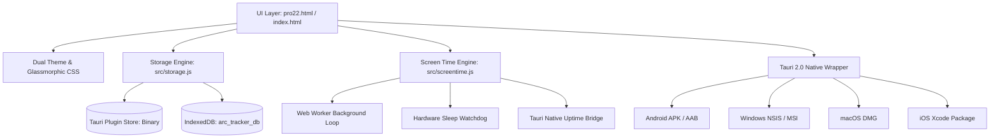

# ⚡ Welcome to the Arc Tracker 2026 Wiki

> **Arc Tracker** is a high-performance, 100% air-gapped, offline-first discipline and habit tracking ecosystem designed for the **Winter Arc** and **Summer Arc** challenges. Built with **Tauri 2.0**, **Vite**, and high-contrast glassmorphic design systems across **Android**, **iOS**, and **Desktop (Windows / macOS)**.

---

## 📑 Table of Contents

- [1. Core Philosophy & Features](#-core-philosophy--features)
- [2. Installation Guide](#-installation-guide)
  - [Android (.apk)](#android-apk)
  - [Desktop (Windows & macOS)](#desktop-windows--macos)
  - [iOS (iPhone & iPad)](#ios-iphone--ipad)
- [3. User Guide & Core Systems](#-user-guide--core-systems)
  - [Daily Habit Grading (S to F Ranks)](#daily-habit-grading-s-to-f-ranks)
  - [Multi-Device Screen Time Engine](#multi-device-screen-time-engine)
  - [Dual Theme System (Light & Dark OLED)](#dual-theme-system-light--dark-oled)
  - [Security PIN Keypad](#security-pin-keypad)
  - [Data Backup & Migration](#data-backup--migration)
- [4. Technical Architecture](#-technical-architecture)
- [5. Frequently Asked Questions (FAQ)](#-frequently-asked-questions-faq)

---

## 🌟 Core Philosophy & Features

### 🛡️ 100% Offline-First & Air-Gapped Privacy
- **Zero Cloud Reliance:** No logins, no remote database servers, no third-party trackers, and no advertising beacons.
- **Client-Side Encryption:** All habits, logs, streaks, and journal entries are encrypted and stored locally via IndexedDB and the Tauri Plugin Store.
- **Airgap Content Security Policy (CSP):** All fonts, Tailwind styles, and FontAwesome icons are strictly bundled offline inside `/public/assets/`.

### 🎮 RPG Habit Gamification
- **Daily Rank System:** Dynamic grading from **Rank S** (100% perfection), **Rank A**, **Rank B**, **Rank C**, down to **Rank F**.
- **Radar & Spider Chart:** Real-time multi-dimensional visualizer displaying balance across physical, mental, focus, and lifestyle disciplines.
- **Interactive Heatmap:** 365-day calendar visualization tracking consistency and momentum over time.
- **Level-Up Milestones:** Experience points (XP) calculation and unlockable victory certificates.

---

## 📲 Installation Guide

### Android (.apk)

1. Navigate to **[Actions ➔ Build and Release Arc Tracker](https://github.com/mayank-pixel-cell/mayank/actions)**.
2. Select the latest completed workflow run.
3. Under **Artifacts** at the bottom, download **`Arc-Tracker-Android-APK`**.
4. Open the downloaded `.zip` in your phone's **Files** app and tap **Extract**.
5. Tap **`Arc-Tracker-release-signed.apk`** to install.
   > **Note:** If Google Play Protect warns that the app is from an unknown developer, tap **"More details"** ➔ **"Install anyway"** (the app is self-signed and 100% open source).

---

### Desktop (Windows & macOS)

Downloads are available under [Releases](https://github.com/mayank-pixel-cell/mayank/releases):

- **Windows:** Download and run `Arc.Tracker_1.0.0_x64-setup.exe` (or `.msi`).
- **macOS:** Download `Arc.Tracker_1.0.0_aarch64.dmg`, open it, and drag Arc Tracker into your Applications folder.
- **Quick Local Launch:** Double-click `Launch-ArcTracker.bat` to launch the offline native window locally.

---

### iOS (iPhone & iPad)

#### Zero-Install Standalone Web App (PWA):
1. Serve the app over your local Wi-Fi via `npm run dev -- --host` or host the static `dist/` directory.
2. Open Safari on your iPhone/iPad and navigate to your host address.
3. Tap the **Share** icon at the bottom of Safari.
4. Tap **"Add to Home Screen"** and press **Add**.
5. Launches full-screen in standalone mode without browser bars or URL inputs, with complete offline IndexedDB persistence.

---

## 📖 User Guide & Core Systems

### Daily Habit Grading (S to F Ranks)

| Grade | Completion Rate | Status | Visual Indicator |
| :---: | :---: | :---: | :---: |
| **S** | 100% | Legendary Discipline | Emerald Neon Glow |
| **A** | 80% – 99% | Elite Momentum | Cyan / Teal Accent |
| **B** | 60% – 79% | Solid Progress | Blue Accent |
| **C** | 40% – 59% | At Risk | Amber Warning |
| **F** | < 40% | Critical Deficit | Rose / Crimson Alert |

### Multi-Device Screen Time Engine

Arc Tracker features a background screen time and focus telemetry system:
- **Background Tracking Worker:** Keeps recording elapsed focus time accurately even when minimized.
- **Hardware Sleep & Lid Watchdog:** Automatically pauses tracking when the computer goes into deep sleep or the laptop lid is shut.
- **System Uptime Bridge:** Uses native hardware counters (`GetTickCount64` on Windows) to verify true device uptime.

### Dual Theme System (Light & Dark OLED)

- **Light Mode:** Modern frosted glassmorphism (`rgba(255, 255, 255, 0.88)`), high-contrast deep slate typography, soft multi-tier elevation drop shadows, and saturated emerald/cyan badges.
- **Dark / OLED Mode:** Deep midnight `#060913` contrast optimized for AMOLED battery saving and zero-strain night tracking.
- **Quick Switch:** Tap the ☀️ / 🌙 button in the header bar or toggle between Light, Dark, and OLED in the Settings Drawer.

### Security PIN Keypad

- Protects your personal journal entries and habits from unauthorized eyes on shared devices.
- Enable your 4-digit PIN via the Settings Drawer (`⚙️`).
- Supports emergency device wipe, vibration haptic feedback, and instant screen locking.

### Data Backup & Migration

- **Export:** In Settings, click **"Export Backup (JSON)"** to download an encrypted snapshot of all habits, logs, and calendar grades.
- **Import:** Click **"Import Backup"** and select your JSON file to seamlessly restore your data on any other phone, tablet, or PC.

---

## 🏗️ Technical Architecture

- **Frontend:** Pure Vanilla JavaScript + Tailwind CSS engine + HTML5 Semantic DOM.
- **Runtime:** Vite 5.4 + Tauri 2.2 native Rust bridge.
- **Continuous Integration:** Headless GitHub Actions workflow (`.github/workflows/build-and-release.yml`) cross-compiling for Ubuntu (Android), macOS (iOS + DMG), and Windows (MSVC).

---

## ❓ Frequently Asked Questions (FAQ)

#### Q: Why did Android say "App can't be installed"?
- **Conflicting signature:** If you previously installed a test or debug build, Android will refuse to overwrite it. Simply **uninstall the old Arc Tracker app** from your phone first, then tap the new `.apk`.
- **Downloaded a `.zip`:** GitHub Actions bundles downloads in a ZIP. Ensure you extract the `.zip` in your phone's file manager and tap `Arc-Tracker-release-signed.apk`.
- **Do not install `.aab`:** Android devices cannot directly install Google Play Store bundles (`.aab`). Always install the `.apk` file.

#### Q: Does Arc Tracker drain battery in the background?
No. The background screen time listener uses low-overhead timer ticks and immediately suspends execution when device idle or sleep states are detected.

#### Q: How do I transfer my data from my computer to my phone?
Go to **Settings** on your computer ➔ tap **Export Backup (JSON)**. Send the `.json` file to your phone, open Arc Tracker on your phone, open **Settings** ➔ tap **Import Backup**.

---

*Arc Tracker 2026 — Master your habits. Own your arc.*
